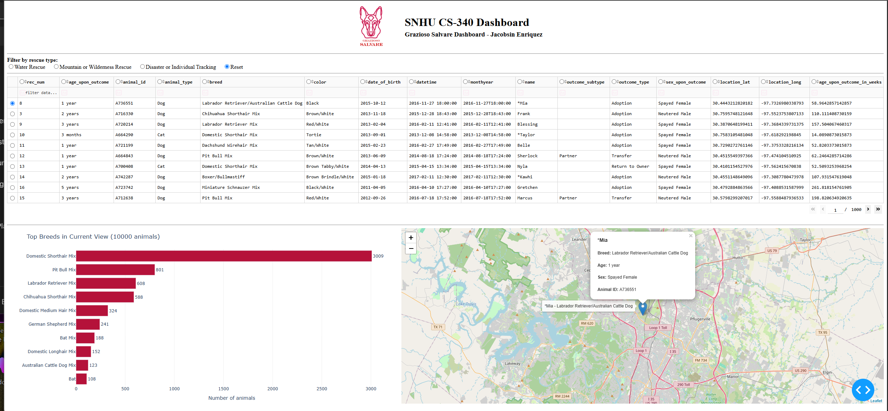

# CS-340 Client/Server Development: Grazioso Salvare Rescue Dog Dashboard

**Jacobsin Enriquez | Southern New Hampshire University | October 2026**

A full-stack web application that helps Grazioso Salvare, an international rescue-animal training company, find shelter dogs suited to search-and-rescue training. A MongoDB database holds the Austin Animal Center Outcomes data set (Austin Animal Center, 2020), a reusable Python CRUD module provides database access, and an interactive Dash dashboard lets staff filter animals by rescue type, browse the matching records, compare breeds, and locate each candidate on a map.

## Repository Contents

| File | Description |
|---|---|
| `ProjectTwoDashboard.ipynb` | Final dashboard: rescue-type filters, interactive data table, breed chart, and geolocation map |
| `CRUD_Python_Module.py` | Project One CRUD module (`AnimalShelter` class) used by the dashboard for every database query |
| `ProjectTwoQueryTests.ipynb` | Unit tests that verify every rescue query against its breed, sex, and age rules |
| `CS340_ProjectTwo_README_Enriquez.docx` | Full project documentation: functionality, tools and rationale, reproduction steps, testing, challenges, and screenshots |
| `screenshots/` | Dashboard screenshots |

Setup and run instructions are in the Getting Started section of the Word README.

## Reflection

### How do you write programs that are maintainable, readable, and adaptable?

I write programs that are maintainable by giving each piece of code one job and keeping that job in one place. The CRUD Python module from Project One holds all of the database logic in a single `AnimalShelter` class. Each method validates its input, handles errors with try/except blocks, and returns a predictable value instead of crashing the calling program. Readability comes from clear names, docstrings, and comments written for the next person who has to service the code, much like a technician leaving clear notes on a work order. Adaptability comes from configuration: the host, port, database, and collection are constructor parameters with defaults, so the module connects to a different database without any changes to its code.

The advantage of working this way showed up in Project Two. The dashboard reused the module without a single change, and every rescue filter, the Reset option, and the unit tests all run through the same `read()` method. When something did not work, I knew exactly where to look. I applied the same thinking to the dashboard itself: the three rescue profiles are stored as data in one dictionary, and one function builds the query for any profile, so a new rescue type is a data change rather than new code. I also replaced position-based column lookups in the map with name-based lookups, which removed a fragile dependency that could have broken the map silently.

In the future, this module could serve any MongoDB collection: other shelter data, inventory records, or equipment maintenance logs. It could also become the data layer behind a REST API, a scheduled reporting script, or a different front end, because the module does not depend on the dashboard that uses it.

### How do you approach a problem as a computer scientist?

I start with the client's requirements and break the problem into layers that can be built and tested one at a time. For Grazioso Salvare, I first translated the Rescue Type and Preferred Dog Breeds table from the specification into data before writing any interface code. The project was built in stages: the database and user account, then the CRUD module, then a data table and map, and finally the filters and charts. Each stage was tested before the next one depended on it. When the specification and the client's mockups disagreed about whether mixed breeds should count, I did not guess. I wrote unit tests for both approaches, compared the results (5 versus 19 Mountain Rescue candidates and 4 versus 28 Disaster candidates), chose the option that matched the mockups, and documented the trade-off.

This project differed from previous assignments in scale and in audience. Earlier assignments were usually self-contained programs with a single deliverable. This was a full stack built over several modules for a client, where each piece was reused by the next, tested at three levels (unit, integration, and regression), and documented so that someone else could reproduce and maintain it.

In the future, I would create databases for other clients by gathering requirements and sample data first, designing queries around the questions the client actually needs answered, and giving applications least-privilege accounts. MongoDB's role-based access control supports this by granting each user only the roles it needs (MongoDB, n.d.). I would also write query tests early, keep credentials out of the code, and use version control from the first commit.

### What do computer scientists do, and why does it matter?

Computer scientists turn data and requirements into reliable tools that people can use to make better decisions. The work matters because a well-designed system removes friction from someone else's job, much like a good diagnostic tool points a technician straight to the problem instead of making them inspect every component.

Without a tool like this, finding training candidates for Grazioso Salvare would mean searching 10,000 shelter records by hand or writing database queries. The dashboard reduces that to one click: 17 Water Rescue candidates, 19 Mountain or Wilderness Rescue candidates, and 28 Disaster or Individual Tracking candidates, each with breed, age, sex, and location available immediately. Staff can spend their time evaluating and training dogs instead of searching data, with fewer errors and less training required to use the tool. Because the code is open source and modular, similar organizations can adapt it to their own data, extending the benefit beyond a single company.

## References

Austin Animal Center. (2020). *Austin Animal Center outcomes* [Data set]. City of Austin, Texas Open Data Portal. https://doi.org/10.26000/025.000001

MongoDB. (n.d.). *Role-based access control in self-managed deployments*. MongoDB Database Manual. https://www.mongodb.com/docs/manual/core/authorization/
